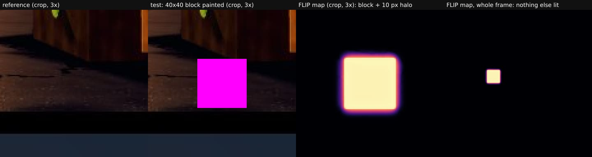
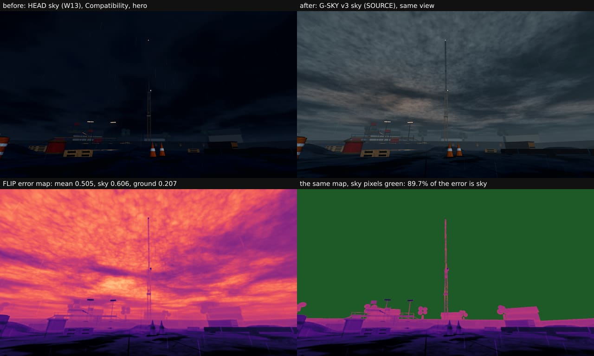
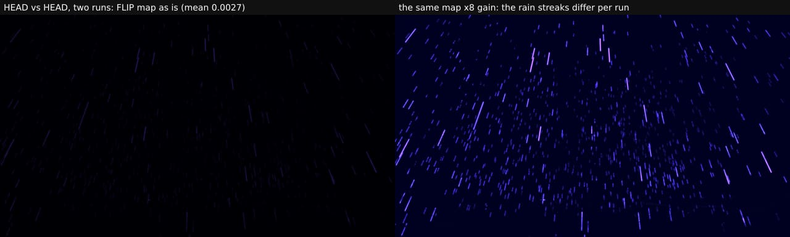
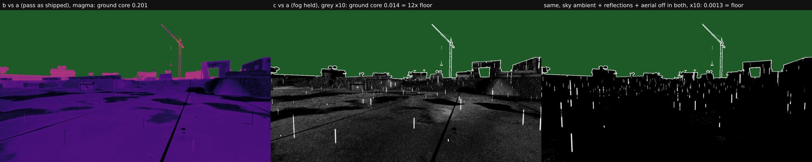

# W17 QA-FLIP: one perceptual number per fixed view (NVIDIA FLIP 1.7)

Lane QA-FLIP, card QA-FLIP-1 (`docs/design/TOOLS_RADAR.md` §3.4). It adds one objective number to every AAA pass
(SKY, WET, AIR, BACKDROP; `docs/design/AAA_PLAN.md`): for each fixed view, the perceptual difference **before vs after**
and **Godot vs twin**, with an error map that shows where the difference is. It sits beside the 30 m team read
(`AAA-30M.md`, `tools/aaa-30m.mjs`), which measures ΔE and ΔL\* on the pets, and does not replace it. QA-FLIP made
nothing it measures.

**Results (2026-10-23, tree `c9c0c6f`):**
- **Install:** hash-pinned, passes the radar's gate. The wheel's full sha256 matches the radar's
  `6fdf6736…1b62`, its licence is BSD-3-Clause, and it has no dependencies (see the install section).
- **Proof 1, identical images give 0.000:** mean, p95 and max are all 0.000000 on the three committed
  `aaa30m-*-1x` shots and on a 1280x720 Godot frame.
- **Proof 2, a local change lights only that spot:**
  - **Change:** a 40x40 block painted on `aaa30m-face-1x`.
  - **Mean:** 0.005331.
  - **Where:** the block itself holds 75.6 % of the error. The block plus 12 px holds 100 %. Every pixel outside that
    is exactly 0.
- **Proof 3, the SKY pass:**
  - **Pair:** HEAD's W13 sky against G-SKY's v3 SOURCE sky, 4 views × 2 renderers.
  - **Sky:** a non-zero mean that sits mainly in sky pixels: sky mean 0.54–0.61, and **63–93 % of the error lies in
    sky pixels**.
  - **Ground: not "confined to sky".** The ground also changes, by far more than noise: ground mean 0.07–0.23, against a
    run-to-run floor of 0.001–0.002 (60–175× that floor). The lead ruled that the radar's "confined" was the wrong bar
    for this pass; the ground change must be explained term by term instead (QA-FLIP-1b, § 3b).
- **The SKY pass's FLIP bar (QA-FLIP-1b, § 3b):** "sky share reported; ground change ≤ 2× the floor once the pass's
  declared terms are held". Measured on v3 at SKY_ENERGY 0.60, 4 views × 2 renderers.
  - **SKY pass FLIP verdict: PASS on its declared terms** (lead ruling, 2026-10-23).
  - **The declared terms:** the sky texture; the fog (the horizon × SKY_ENERGY); and the sky's radiance **colour**,
    through the ambient and the reflections. The radiance **level** stays at SKY_LIGHT_ENERGY 0.12.
  - **The evidence:** with all of them held, the ground core is at its floor (0.8–1.2×, Compatibility).
  - **The fog alone** explains 90–93 % of the ground change in Compatibility, and 67–73 % in Forward+, whose floor is
    higher.
  - **With the fog alone held**, the ground stays at 6–12× its floor in Compatibility and 1.9–3.2× in Forward+. That
    leftover is the radiance map's colour: the ground core turns less blue (Δb\* +0.3 to +0.5, ΔL\* −0.05 to −0.18,
    ΔE of the means 0.3–0.55). It is declared post hoc, by the ruling recorded in § 3b.
- **Runtime:** 2.8–3.4 s per 1280x720 pair for the wrapper (two FLIP runs plus the mask stats). A single FLIP run takes
  about 1.1 s. Measured at load 5–6 on the shared 4 cores; the bar is ≤ 5 s.

## What FLIP measures, and what it does not

- **What it is:** FLIP (Andersson et al., HPG 2020, "FLIP: A Difference Evaluator for Alternating Images") models what
  a viewer sees when flipping between two images at a given viewing distance.
  - It filters both images by the eye's contrast sensitivity at that distance (default 67 pixels per degree: a 0.7 m
    wide 4K screen seen from 0.7 m).
  - It compares the colours in a perceptual space and adds a term for edges and points.
  - Each pixel gets an error in [0, 1], and the mean is the summary number.
- **Why the change spreads:** the filter spreads a change over a few pixels. The 40x40 block shows a halo of about
  10 px.
- **What it is not:** it is a difference, not a quality score. A lower number means *closer to the reference*, not
  better looking. A pass that improves the sky will have a large before/after FLIP, and that is fine. What we read is
  **where** the error sits (the map and the mask split) and, for parity, **how far apart** Godot and the twin are.
- **Mode used here:** LDR-FLIP on 8-bit sRGB screenshots. FLIP's HDR mode, which works on EXR, is not used here: the
  engines' frames are tone-mapped 8-bit PNGs. It could be used later to compare the sky SOURCE EXR itself.
- **What it ignores:** it knows nothing about meaning. It does not know that a pet is more important than a cloud.
  Masks put that back: a sky, ground or pet region. For team read it does not replace `aaa-30m.mjs`.

## Install (scratch venv, hash-pinned; never in the repo, never in package.json)

- **Python:** `python3` here is 3.11.15, so the radar's cp311 manylinux x86_64 wheel applies as is.
- **The wheel's metadata**, from PyPI's JSON API (`https://pypi.org/pypi/flip-evaluator/1.7/json`):
  - File: `flip_evaluator-1.7-cp311-cp311-manylinux_2_17_x86_64.manylinux2014_x86_64.whl`, 418,713 bytes, uploaded
    2025-11-07.
  - sha256: `6fdf6736f4665dd913edf19b7eb94c78a640a95b885a3e95b473f40f7bdd1b62`.
  - The download was re-hashed with `sha256sum` and matches. It equals the radar's `6fdf6736…1b62`.
- **Licence:** `flip_evaluator-1.7.dist-info/licenses/LICENSE` is the BSD 3-Clause License, © 2020-2025 NVIDIA
  (`SPDX-License-Identifier: BSD-3-Clause`).
- **What the wheel contains:**
  - The `nbflip` extension. It carries tinyexr symbols; the tinyexr and stb licence texts are not in the wheel.
  - The Python front end.
  - `libgomp` (the GCC OpenMP runtime, bundled by auditwheel; GPL-3 with the GCC Runtime Library Exception). It is
    used only by this offline tool and nothing is shipped.
- **Dependencies:** none. METADATA has no `Requires-Dist`, so there is nothing else to pin.
  - numpy is **not** needed. The `flip` CLI ran without numpy installed.
  - Only the Python API's `evaluate()`, which returns arrays, would want numpy, and the wrapper does not use it.
- **What the venv holds:** `flip-evaluator 1.7`, plus `pip 24.0` and `setuptools 79.0.1`, which come with the venv
  itself. No other package was installed.

```sh
S=<scratchpad>; mkdir -p $S/qa-flip
curl -sS -o $S/qa-flip/flip.json https://pypi.org/pypi/flip-evaluator/1.7/json   # read the digest of the cp311 wheel
printf 'flip-evaluator==1.7 \\\n    --hash=sha256:6fdf6736f4665dd913edf19b7eb94c78a640a95b885a3e95b473f40f7bdd1b62\n' > $S/qa-flip/requirements-flip.txt
/usr/bin/python3.11 -m venv $S/flip-venv
$S/flip-venv/bin/pip install --no-cache-dir --require-hashes --only-binary=:all: -r $S/qa-flip/requirements-flip.txt
$S/flip-venv/bin/flip --help        # "FLIP v1.7."
```

Remove the tool with `rm -rf $S/flip-venv`. On another Python, the wheel and its hash differ: take that wheel's digest
from the same JSON and pin it in the same way.

## Commands

```sh
export FLIP_BIN=$S/flip-venv/bin/flip            # or --flip <path>; a clear error when neither is set
node tools/qa-flip.mjs pair before/hero.png after/hero.png --out artifacts/qa-flip/hero [--mask sky/hero.png]
node tools/qa-flip.mjs dirs before/ after/ --out artifacts/qa-flip/sky [--mask-dir masks/] [--max-mean 0.05]
```

- **Pairing:** `dirs` pairs the two folders' `*.png` by **file name**. A view on one side only is an error (exit 2),
  never a skip.
- **Inputs:** PNG only. FLIP 1.7 reads png, exr, bmp and tga, not jpg, so convert first.
- **The two FLIP runs per view:**
  1. `-nm` writes a grey map whose value/255 is the per-pixel error. The wrapper checks its mean against FLIP's printed
     mean, to 0.5/255; a format change fails loudly.
  2. The default run writes the magma map, the one to look at. `--no-magma` skips it.
- **Per view the wrapper writes:**
  - mean, p95 and max;
  - the map paths;
  - FLIP's own pooled values (mean, weighted median and quartiles, min, max, ppd, evaluation time).

  The views go into `results.json`, with a one-line verdict printed and in `verdict.txt`.
- **Which numbers:**
  - Without a mask, mean and max are FLIP's printed numbers, and p95 (nearest rank over pixels) comes from the grey map.
  - With `--mask` (one PNG) or `--mask-dir` (one per view, same file name), the headline mean, p95 and max are the
    **region's**. A pixel is in the region where any of R, G, B is ≥ 128, and alpha is ≥ 128 if there is one; a 30 m
    matte works as it is. They are read from the grey map and so quantised to 1/255.
  - The complement is reported beside the region, with each side's **share of the summed error**.
- **Exit codes:** 0 means measured, and at or under `--max-mean` if given. 1 means a view is above `--max-mean` (the
  region's mean when masked), and the verdict names each such view. 2 means it could not measure: no binary, a missing
  view, file or mask, a size mismatch, a FLIP failure or bad arguments.
- **Load:** the wrapper runs at nice 10. FLIP uses OpenMP on all cores for about a second per pair.

## The three proofs

### 1. Identical images give 0.000

```
node tools/qa-flip.mjs dirs ident ident --out out-ident --max-mean 0
aaa30m-face-1x     mean 0.0000  p95 0.0000  max 0.0000
aaa30m-horizon-1x  mean 0.0000  p95 0.0000  max 0.0000
aaa30m-side-1x     mean 0.0000  p95 0.0000  max 0.0000
v3-compat-hero     mean 0.0000  p95 0.0000  max 0.0000      (1280x720)
QA-FLIP PASS: 4 view(s) at or under --max-mean 0
```

- **Inputs:** the committed `docs/qa/w17/aaa30m-{face,side,horizon}-1x.jpg` (sha256 `ef3c781e…`, `0b52a500…`,
  `aa1ad939…`), converted losslessly to PNG at 800x486, each against itself.
- **Result:** FLIP printed Mean, Weighted median, both quartiles, Min and Max as 0.000000 for each.

### 2. A small, local change lights only that spot



- **The change:** `aaa30m-face-1x` with a 40x40 magenta block at (300, 200).
- **FLIP's report:** Mean 0.005331, Weighted median 0.976662, Max 0.985037.
- **Where the error is:**

| Region (`--mask`) | px | mean | share of all error | outside: mean / max |
|---|---|---|---|---|
| the block | 1,600 | 0.979 | 75.6 % | 0.0013 / (the halo) |
| the block + 12 px | 4,096 | 0.506 | **100.0 %** | **0.0000 / 0.0000** |

- **The halo:** the non-zero pixels span x 290–349 and y 190–249, which is the block plus 10 px on each side. That
  is FLIP's spatial filter at 67 ppd.
- **Nothing else is lit:** in the whole-frame map (opened, and the right cell above), no pixel outside the block's halo
  is non-zero.

### 3. A known change: the SKY pass (Godot before vs after, error inside sky pixels)



- **The pair:** G-SKY's own paired renders. They come from the same script, eye, target, fov 72 and 1280x720, with rain
  on and no HUD, at the views spawn, slab 10 m, slab 30 m and hero, in both renderers. Before and after are in
  `scratchpad/g-sky/shots/views/`, copied for this run to `scratchpad/qa-flip/sky/`.
  - **Before** (`before_*`, 2026-10-17): HEAD's W13 procedural sky.
  - **After** (`v3_*`, 2026-10-18): BL-DCC's v3 sky drawn as the SOURCE (`docs/handoff/G-ATMOS.md` § v3). These views
    predate the lane's later SKY_ENERGY 0.60 re-run, whose views did not exist when this was measured. § 3b
    re-renders the pass at 0.60.
- **The sky masks:** rendered by QA-FLIP, with the lead's standing rules on load.
  - **Tree:** a private `git archive c9c0c6f` copy with a fresh `--import`, in Godot 4.7.2 Compatibility under
    `xvfb-run`, at nice 10 and load 2–5.
  - **Views:** the same four views. The printed eyes match G-SKY's logs to the digit.
  - **Method:** a full-screen quad reads the depth buffer. The mask is white where nothing is nearer than 0.98 × far
    (1000 m), which is the sky. Rain over the sky counts as sky because it writes no depth. This is the cover test's
    sky mask method (`test_look_cover.gd`).
  - **Check:** the hero mask was overlaid on the v3 frame and checked by eye. It hugs the mast, the cranes, the lamps
    and the sheds.
  - **One mask for both renderers:** the geometry is the same, and Forward+'s volumetric fog writes no depth.
- **Before is HEAD:** HEAD `c9c0c6f`'s own render of the four views, set against G-SKY's "before", is at the noise floor
  (full mean 0.0016–0.0029).

| Renderer | View | Full mean | Sky px | **Sky mean** (p95) | **Ground mean** (p95, max) | **Sky's share of the error** |
|---|---|---|---|---|---|---|
| Compatibility | hero | 0.505 | 689,915 | **0.606** (0.725) | 0.207 (0.490, 0.733) | **89.7 %** |
| Compatibility | slab 10 m | 0.278 | 343,443 | **0.584** (0.729) | 0.097 (0.459, 0.733) | **78.2 %** |
| Compatibility | slab 30 m | 0.303 | 384,021 | **0.586** (0.725) | 0.101 (0.467, 0.733) | **80.6 %** |
| Compatibility | spawn | 0.371 | 367,616 | **0.587** (0.733) | 0.228 (0.310, 0.855) | **63.1 %** |
| Forward+ | hero | 0.450 | 689,915 | **0.558** (0.678) | 0.129 (0.267, 0.690) | **92.8 %** |
| Forward+ | slab 10 m | 0.245 | 343,443 | **0.537** (0.690) | 0.072 (0.228, 0.694) | **81.7 %** |
| Forward+ | slab 30 m | 0.268 | 384,021 | **0.539** (0.682) | 0.074 (0.231, 0.706) | **83.8 %** |
| Forward+ | spawn | 0.276 | 367,616 | **0.537** (0.694) | 0.103 (0.177, 0.824) | **77.6 %** |

The noise floor, HEAD rendered twice (same tree, same views, Compatibility): full mean 0.0016–0.0027, sky 0.0025–0.0030,
ground 0.0009–0.0022, max 0.19–0.20. The floor is rain streaks only, because the particles differ per run (map below,
×8 brightness).



- **The sky:** the error is the sky's, and it is large: mean 0.54–0.61, about 200× the floor. The sky pixels hold
  63–93 % of the error.
- **The ground: real, not noise.** The ground mean is 0.07–0.23, which is 60–175× its floor. The maps show where it is
  (sky painted green below):
  - **Compatibility:** the whole lit ground shifts uniformly (map value about 0.2), and the far buildings near the
    horizon shift more (0.4–0.7, pink). That is the ambient light and the haze moving to the new sky's colours.
  - **Forward+:** the ground moves about half to two-thirds as much, and its map also shows rain streaks.
  - **The cause:** the pass changes the fog as well as the sky (fog = the receipt's horizon × SKY_ENERGY), and the sky
    also feeds the radiance map. § 3b splits the two causes.

**Error maps opened and checked by eye:**
- for every SKY view, the composites of before | after | map (hero and spawn are shown above);
- the hero mask over the v3 frame;
- the spawn ground-only maps, both renderers;
- the block's map, crop and whole frame;
- the floor map for hero;
- for § 3b: the (c) vs (a) ground maps at ×10, hero and spawn, and the three spawn panels below.

### 3b. The SKY pass's FLIP bar: the ground change explained (QA-FLIP-1b)

**The lead's ruling (2026-10-23).** The radar's wording, "confined to sky pixels", was wrong for this pass. By design,
the SKY pass changes two things:
- the sky texture;
- the fog: its colour is the receipt's horizon, and its energy is SKY_ENERGY.

Godot keeps SKY_LIGHT_ENERGY, the radiance map, at item 11's level. A bar fitted to today's numbers ("sky share ≥ 60 %,
ground ≤ 0.25") is **not** adopted. The bar is:

> **Sky share reported; ground change ≤ 2× the floor once the pass's declared terms are held.**

The same pattern applies to every later pass. WET declares the ground; AIR declares the haze and the shafts; BACKDROP
declares the far band.

**The trees.** Each is a private `git archive c9c0c6f` copy with a fresh `--import`, and nothing is written to the
shared tree.
- **(a) HEAD:** the W13 sky.
- **(b) the pass as shipped:** (a) plus the shared tree's `engines/godot/look/look.gd` and `look/night_sky.gdshader`,
  copied read-only (sha256 `0093d8fa…` and `a40b0bea…`). That is BL-DCC's v3 sky (`assets/sky/lot_night_sky.exr`,
  committed at HEAD) at SKY_ENERGY 0.60, with SKY_LIGHT_ENERGY 0.12.
- **(c) the fog held:** (b) with only the two fog lines in `_build_environment` set back to HEAD's W13 values:
  `fog_light_color = SKY_FALLBACK_HORIZON` (0.11, 0.13, 0.17), and `fog_light_energy = 1.0` where (b) has
  `SKY_ENERGY`. Nothing else in the file uses the sky's colours.
- **The floor:** (a) rendered twice.

**The renders.** The views and the script are proof 3's: G-SKY's four `skyshot.gd` views, fov 72, 1280x720, 20
settle frames, rain on. They were rendered in both renderers, one Godot at a time, at nice 10, each started only at
load5 < 7. The scripts are in `docs/qa/w17/flip-scripts/` (see Reproduce).

**The masks.**
- The sky mask is the depth mask from proof 3.
- The **ground core** is every ground pixel with no sky pixel within 12 px (`flip-scripts/groundcore.mjs`). FLIP's
  filter spreads the sky's large change about 10 px across the skyline, and proof 2 measured that halo. Without the
  margin, the skyline outline would count as a ground change: it is the white rim in the panels below.
- The ground numbers below are the ground core's.

**First measurement, with the fog as the only declared term: FAIL.**
- **What holding the fog leaves:** the ground core is 6.2–12.4× its floor in Compatibility (all 4 views). In Forward+
  it is 1.9× on hero and 3.1–3.2× on the other three.
- **What the fog explains:** with the fog held, the ground core falls from 0.067–0.20 to 0.007–0.014 in Compatibility,
  90–93 % of the change. In Forward+ it falls from 0.054–0.099 to 0.017–0.031, 67–73 %; that renderer's own floor
  is 0.006–0.016.
- **What (b) vs (c) shows:** the fog's own change is the same size as the whole pass's on the ground. The fog also tints
  the sky slightly (sky mean 0.09, through `fog_sky_affect` 0.15).

**What else reaches the ground: the radiance map's colour, through both the sky ambient and the sky reflections.**
- **The diagnostics:** (c) vs (a) again in Compatibility, each time with one sky-radiance path set the same in both
  trees.
- **Aerial perspective:** setting it to 0 changes nothing. On Compatibility it has no effect at these views.
- **Sky reflections off alone:** removes 27–50 % of the residual.
- **Sky ambient off alone:** removes none; the residual is a little higher.
- **All three off:** the ground core is at its floor (0.8–1.2×).
- **What it is in colour:** the mean L\*a\*b\* of the ground core, (c) against (a). It is a hue shift: the ground is
  less blue under v3's radiance map than under W13's.
  - Compatibility: Δb\* +0.29 to +0.49, Δa\* −0.02 to −0.16, ΔL\* −0.05 to −0.09.
  - Forward+: Δb\* +0.36 to +0.51, ΔL\* −0.09 to −0.18.
  - The ΔE76 of the means is 0.3–0.55: real, since it is many times the floor, and below a just-noticeable step as a
    mean.
  - With the reflections held, Δb\* falls to +0.05 to +0.10. So the reflections carry most of the hue, and the ambient
    carries the rest.
- **What it means for "Godot keeps SKY_LIGHT_ENERGY at item 11's level":**
  - The **level** holds: ΔL\* is ≤ 0.18 on a ground core at L\* 2–12.
  - The **colour** changes. The radiance map is SOURCE × 0.12, and the SOURCE's hue is not the W13 sky's.
  - G-ATMOS calibrated the probe spheres' matte level (0.0268 → 0.027), not their hue.

**The lead's ruling (2026-10-23, after the first measurement): the radiance colour is a declared SKY-pass term.**
- **What it is:** the radiance map's colour, reaching the ground through the ambient and the reflections, is declared a
  term of the SKY pass. It is **not** tinted back to W13.
- **The reason:** wet asphalt reflecting the new sky is what the SKY pass is for (NORTH_STAR: an overcast deck lit warm
  from below, reflected in the wet yard). Matching W13's hue would undo the pass.
- **What stays fixed:** the radiance **level** stays at SKY_LIGHT_ENERGY 0.12, as G-ATMOS calibrated it.
- **The SKY pass's declared terms:**
  1. the sky texture;
  2. the fog: its colour is the horizon, and its energy is SKY_ENERGY;
  3. the sky's radiance colour, through the ambient and the reflections.
- **The evidence:** the per-path table below, last row. With the fog held and the sky ambient, sky reflections and
  aerial perspective set the same in both trees, the ground core is **0.8–1.2× its floor**: nothing undeclared reaches
  the ground. Aerial perspective is a fog term, and it has no effect here.
- **The verdict: SKY pass FLIP = PASS on its declared terms.**
- **Scope of the evidence:**
  - The all-terms-held run is Compatibility only, divided by the (a)-twice floor.
  - Forward+ was measured with the fog held: 1.9–3.2×. Its leftover has the same colour signature: Δb\* +0.36 to
    +0.51, ΔL\* −0.09 to −0.18.
  - A Forward+ all-terms-held pair was not rendered. It would be the confirmation if one is wanted; SSR there also
    reflects the scene, not only the sky.
  - Every ×-floor number here is reported beside its floor: Compatibility 0.0007–0.002, Forward+ 0.006–0.016.




The tables. FLIP at 67 ppd. The sky columns use the sky mask; the ground columns use the ground core. "× floor" is the
ground-core mean over the same renderer's floor.

**(b) vs (a): the pass as shipped**

| Renderer | View | Full mean | Sky mean | Sky share | Ground-core mean (p95) | Ground core × floor |
|---|---|---|---|---|---|---|
| Compatibility | hero | 0.473 | 0.569 | 90.2 % | 0.1493 (0.412) | 76.5× |
| Compatibility | slab 10 m | 0.257 | 0.548 | 79.3 % | 0.0672 (0.310) | 100.7× |
| Compatibility | slab 30 m | 0.281 | 0.550 | 81.5 % | 0.0714 (0.341) | 88.4× |
| Compatibility | spawn | 0.343 | 0.550 | 63.8 % | 0.2005 (0.243) | 179.7× |
| Forward+ | hero | 0.420 | 0.521 | 93.0 % | 0.0988 (0.200) | 6.2× |
| Forward+ | slab 10 m | 0.225 | 0.500 | 82.5 % | 0.0538 (0.145) | 9.6× |
| Forward+ | slab 30 m | 0.247 | 0.502 | 84.6 % | 0.0563 (0.161) | 9.4× |
| Forward+ | spawn | 0.255 | 0.500 | 78.2 % | 0.0875 (0.122) | 11.8× |

**(c) vs (a): the pass with the fog held (the first measurement)**

| Renderer | View | Full mean | Sky mean | Sky share | Ground-core mean (p95) | Ground core × floor |
|---|---|---|---|---|---|---|
| Compatibility | hero | 0.410 | 0.541 | 98.7 % | 0.0120 (0.035) | **6.2×** |
| Compatibility | slab 10 m | 0.199 | 0.518 | 96.7 % | 0.0070 (0.024) | **10.5×** |
| Compatibility | slab 30 m | 0.222 | 0.520 | 97.2 % | 0.0073 (0.027) | **9.1×** |
| Compatibility | spawn | 0.218 | 0.521 | 95.5 % | 0.0138 (0.031) | **12.4×** |
| Forward+ | hero | 0.380 | 0.494 | 97.4 % | 0.0312 (0.102) | **1.9×** |
| Forward+ | slab 10 m | 0.188 | 0.470 | 93.0 % | 0.0172 (0.035) | **3.1×** |
| Forward+ | slab 30 m | 0.210 | 0.472 | 93.8 % | 0.0185 (0.035) | **3.1×** |
| Forward+ | spawn | 0.204 | 0.470 | 92.2 % | 0.0237 (0.051) | **3.2×** |

**(b) vs (c): the fog alone**

| Renderer | View | Full mean | Sky mean | Sky share | Ground-core mean (p95) | Ground core × floor |
|---|---|---|---|---|---|---|
| Compatibility | hero | 0.116 | 0.093 | 60.3 % | 0.1526 (0.412) | 78.2× |
| Compatibility | slab 10 m | 0.090 | 0.097 | 40.1 % | 0.0695 (0.310) | 104.1× |
| Compatibility | slab 30 m | 0.092 | 0.096 | 43.2 % | 0.0737 (0.345) | 91.2× |
| Compatibility | spawn | 0.162 | 0.095 | 23.4 % | 0.2014 (0.243) | 180.4× |
| Forward+ | hero | 0.096 | 0.090 | 70.0 % | 0.1046 (0.208) | 6.5× |
| Forward+ | slab 10 m | 0.075 | 0.093 | 46.0 % | 0.0582 (0.149) | 10.4× |
| Forward+ | slab 30 m | 0.078 | 0.093 | 49.4 % | 0.0616 (0.165) | 10.3× |
| Forward+ | spawn | 0.093 | 0.092 | 39.3 % | 0.0913 (0.125) | 12.3× |

**Floor (a) vs (a'), HEAD rendered twice**

| Renderer | View | Full mean | Sky mean | Ground-core mean (p95, max) |
|---|---|---|---|---|
| Compatibility | hero | 0.0027 | 0.0027 | 0.0020 (0.012, 0.184) |
| Compatibility | slab 10 m | 0.0016 | 0.0025 | 0.0007 (0.000, 0.200) |
| Compatibility | slab 30 m | 0.0019 | 0.0030 | 0.0008 (0.000, 0.180) |
| Compatibility | spawn | 0.0020 | 0.0030 | 0.0011 (0.004, 0.192) |
| Forward+ | hero | 0.0137 | 0.0127 | 0.0160 (0.098, 0.431) |
| Forward+ | slab 10 m | 0.0097 | 0.0151 | 0.0056 (0.020, 0.451) |
| Forward+ | slab 30 m | 0.0098 | 0.0139 | 0.0060 (0.024, 0.467) |
| Forward+ | spawn | 0.0112 | 0.0160 | 0.0074 (0.035, 0.412) |

**Diagnostics (Compatibility): (c) vs (a) again, with a sky-radiance path set the same in both trees (the per-path evidence for the ruling)**

| Held in both trees | hero | slab 10 m | slab 30 m | spawn |
|---|---|---|---|---|
| nothing (the (c) vs (a) row above) | 0.0120 (6.2×) | 0.0070 (10.5×) | 0.0073 (9.1×) | 0.0138 (12.4×) |
| aerial perspective off | 0.0119 (6.1×) | 0.0071 (10.6×) | 0.0073 (9.1×) | 0.0139 (12.5×) |
| sky ambient off (`ambient_light_sky_contribution` 0) | 0.0159 (8.1×) | 0.0076 (11.3×) | 0.0074 (9.2×) | 0.0176 (15.8×) |
| sky reflections off (`reflected_light_source` disabled) | 0.0060 (3.1×) | 0.0046 (6.9×) | 0.0051 (6.3×) | 0.0101 (9.1×) |
| all three off: **the declared-terms evidence** | 0.0019 (1.0×) | 0.0007 (1.0×) | 0.0006 (0.8×) | 0.0013 (1.2×) |

### Godot vs twin, the other use (an example, not a parity verdict)

- **Frames:** the 30 m baseline's frames at `f7f45b5` (`scratchpad/qa30m/base`). The twin copies Godot's camera.
- **Godot Compatibility against twin WebGL:** face 0.478, side 0.478, horizon 0.317.
- **Godot Compatibility against Godot Forward+:** face 0.171, side 0.171, horizon 0.143.
- **Why the twin number is large:** the twin's frame is brighter overall, and that baseline twin draws the K2 kits and
  a different player model. Like the 30 m read's twin FAIL, the number is a finding to track, not something this lane
  changes.
- **With the 30 m matte as a pets mask:** the pets are 206–329 px of 921,600 (0.0–0.1 % of the error). At 30 m the
  whole-frame number is the world's, not the pets'.

## How every pass uses it

1. **Fixed bookmarks:** the same script, eyes, fov, resolution and settle as the pass's own shots, for example G-SKY's
   `skyshot.gd` views or the 30 m views. Render **before** at the base SHA and **after** at the pass tree, into two
   folders with the same file names.
2. **Turn rain off** when the engine allows it, because the streaks are the floor. Otherwise, measure the floor once by
   rendering the base twice: `dirs base-run1 base-run2`.
3. **A region mask per view, rendered once from the depth buffer at the base SHA:** a sky mask for SKY and AIR, and its
   complement or a ground mask for WET. Then run
   `node tools/qa-flip.mjs dirs before after --out <dir> --mask-dir masks`.
   - Report per view: the region mean, the complement mean, and the region's share.
   - Report the floor next to them.
   - Look at each magma map.
4. **Godot vs twin per view:** `dirs godot-<config> twin-<config>` at the same SHA and views (the 30 m tool already
   renders both). Track the mean per view across passes. A pass should not raise it on a view it did not mean to change.
5. **Hold the pass's declared terms; the rest must sit at the floor** (the bar, § 3b):
   - **What the pass declares:** the terms it changes on purpose.
     - SKY: the sky texture, the fog, and the sky's radiance colour (ambient and reflections, at an unchanged level).
     - WET: the ground.
     - AIR: the haze and the shafts.
     - BACKDROP: the far band.
   - **When the terms are declared:** **before** the pass is measured, in its card. A term declared after the
     measurement needs a lead ruling, recorded with its evidence: the per-path table showing that, once it is held,
     nothing else is above the floor. § 3b is the example.
   - **The extra render:** the pass tree with those terms set back to the base's values, (c).
   - **The FLIP runs:** (b) vs (a), (c) vs (a) and (b) vs (c), with the region mask and its complement. Erode the
     complement by 12 px away from the region, past FLIP's filter halo (`flip-scripts/groundcore.mjs`).
   - **The bar:** the complement's mean in (c) vs (a) is ≤ 2× the base-twice floor, per view and renderer.
   - **If it is above 2×:** find the undeclared term the way § 3b did. Set one path at a time to the same value in both
     trees, and name the path with numbers. Then either fix the pass, or ask for a ruling that declares the path.
   - **Report the floor beside every ×-floor number.** Where the floor is tiny, 2× is strict (see Limits).
6. **Gate only where a ruling sets a number:** `--max-mean` exits 1. Without a ruling, report (exit 0) and let the lead
   read the maps.

## Limits

- **LDR only:** 8-bit sRGB, tone-mapped screenshots. HDR-FLIP, on EXR, is not wired.
- **A difference, not a quality score:** lower is closer, not better looking.
- **Viewing distance:** FLIP's default is 67 ppd (a 4K monitor at arm's length). A different `--ppd` changes every
  number, so keep it fixed across a series.
- **Masked numbers are quantised to 1/255** (0.004), because they come from the 8-bit grey map. The unmasked mean and max
  are FLIP's exact printed values.
- **p95 is unweighted** (nearest rank over pixels). FLIP's own "weighted" median and quartiles are weighted by the
  error and are not percentiles of pixels; they are kept in `results.json` but not used.
- **The SKY pair has rain on:** its floor is 0.002 mean and 0.2 max. Any view-level number under about 0.005 is noise
  here.
- **The sky masks are depth-based:** fog and haze over far geometry count as ground, which is right for "where the
  sky pass changed the world".
- **A bar relative to the floor is strict where the floor is tiny.** Compatibility's ground-core floor is 0.0007–0.002,
  so 2× is 0.0014–0.004. The radiance hue that fails it is a ΔE of 0.3–0.55 on the ground's mean colour. Forward+'s floor
  is 7–8× higher (its volumetric fog's temporal reprojection plus the rain), so the same bar is looser there. Report
  the floor beside every ×-floor number.
- **The diagnostics in § 3b are Compatibility only,** and each is divided by the pair (a)'s floor, not by its own. The
  Forward+ residual has the same colour signature.
- **Godot vs twin has no shared matte here:** the twin's geometry and characters differ from Godot's, so a mask taken
  from one side is only approximate on the other.

## Tests and mutants

- **The suite:** `tests/unit/qa-flip.test.ts` (Vitest, node) drives the wrapper in process, using a **fake `flip`**
  written into the test's temp dir.
  - The fake prints FLIP 1.7's verbosity-2 report, with the line format copied from the real run above.
  - It writes its map with `-d`/`-b` as FLIP does, grey with `-nm`.
  - Its error is |ref − test| of grey inputs, so every expected number is exact.
- **What the tests cover:**
  - the real report's parsing;
  - PNG reading against sharp-written PNGs (every filter, grey, grey+alpha, RGB, RGBA, palette, 16 bit, a 1-bit mask);
  - the mask rule and p95;
  - identity;
  - pairing by name;
  - mismatched names;
  - a missing view;
  - the threshold and its boundary;
  - mask region and share;
  - `--mask-dir`;
  - every exit-2 path, including a FLIP mean that disagrees with its map.
- **The real binary:** one block runs it only when `FLIP_BIN` is set (local): the committed face shot gives identity
  0.000, and the 40x40 block puts 100 % of the error within 12 px with 0 outside. It passed here.
- **CI:** 13 pass, and the real-FLIP test is skipped.
- **Mutants:** each was applied to `tools/qa-flip.mjs` alone, and the file was restored and checked after each run:

| Mutant | Result |
|---|---|
| pair by index: count check plus zip by position | **killed** (same count, different names) |
| a missing view skipped: no check plus intersection | **killed** |
| a missing view skipped: no check | **killed** |
| `--max-mean` not applied | **killed** |
| `--max-mean` boundary (`<` for `<=`) | **killed** |
| `--max-mean` read on the full image under a mask | **killed** |
| the mask ignored | **killed** |
| the mask region inverted | **killed** |
| the mask rule as the colour mean (a red 30 m matte falls out) | **killed** |
| p95 computed as the median | **killed** |
| the grey-map / FLIP-mean check dropped | **killed** |
| FLIP's exit status ignored | **killed** |

Two further one-line variants survive, and they are equivalent by construction:
- zipping by position after the name check: both lists are sorted and proven to hold the same names, so the zip is the
  same;
- intersecting after the name check: the check has already thrown.

## Reproduce

In the repo, `docs/qa/w17/flip-scripts/` (each file < 3 KB):
- `qaflip_views.gd`: the four views. Default mode writes the depth sky masks; `NO_MASK=1` writes the frames. It is
  copied into a private tree's `engines/godot/` and never lives under `engines/godot` in the repo. Its body is the
  script that made every render here.
- `render.sh`: one render of a private tree: one Godot, nice 10, waiting for load5 < 7.
- `groundcore.mjs`: the ground-core masks.

Scratch, never committed:
- `scratchpad/flip-venv`.
- `scratchpad/qa-flip/`, which holds `requirements-flip.txt`, the pairs, the masks (`sky/mask-sky`,
  `sky/mask-groundcore`), the private trees (all deleted after the measurement for disk space; `render.sh` and
  `qaflip_views.gd` rebuild them from `git archive c9c0c6f`) and `mutants.py`.
- `scratchpad/qa-flip/v1b/`: the § 3b frames and results (`out-<pair>-<renderer>-<mask>/results.json`).
- `mkvar.py`: makes the diagnostic trees, one line each in `look.gd`.
- `tab3.py`: prints the tables.

```sh
FLIP_BIN=$S/flip-venv/bin/flip node tools/qa-flip.mjs dirs $S/qa-flip/sky/before-compat $S/qa-flip/sky/v3-compat \
  --out $S/qa-flip/sky/outm-compat --mask-dir $S/qa-flip/sky/mask-sky
FLIP_BIN=$S/flip-venv/bin/flip npx vitest run tests/unit/qa-flip.test.ts      # + the real-binary test
```
